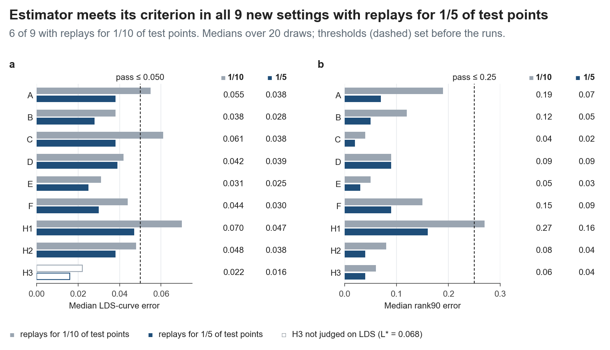

# A Measurement Bound for Training-Data Attribution

Exact training-data attribution costs one full replay of training per test point. This repo asks what a method can reach when it can afford far fewer replays than there are test points and knows nothing else about the exact attributions beyond the mean and length of each row. It proves a ceiling on how closely such a method can be guaranteed to match the exact attributions, measured by cosine similarity: with B replays, the ceiling is set by the share of the exact attribution matrix's energy that lies in its top B singular values.

Under two further conditions (Section 2), the ceiling carries over to the linear datamodeling score (LDS), the usual measure of attribution quality: an estimate's LDS is at most its cosine times the LDS of the exact attributions. Measured on oracle estimates in four settings, LDS exceeded this bound by at most 0.3%. The ceiling can also be estimated before paying for the rest: from exact replays for a fifth of the test points and the retraining runs that LDS is scored on, an estimator fixed in advance met its error criterion in all 9 new small-network settings, and in 6 of 9 with a tenth.



The LDS-curve error is the largest gap, over B = 1…k replays, between the estimated and the actual mean LDS of the oracle estimates; the rank90 error is the relative error of the estimated number of singular values needed to hold 90% of the energy. The dashed lines are the pass thresholds.

---

## 1. Research question

Let **Y** ∈ R^{k×N} be the exact attribution matrix: entry Y_ji is the metagradient of test output f_j with respect to the weight of training point i, taken through the whole (deterministic) training trajectory. One row costs one full adjoint replay. Attribution quality is scored by the linear datamodeling score (LDS): the Spearman correlation, over random fixed-size deletion subsets S, between the predicted response −Σ_{i∈S} ŷ_ji and the measured response after retraining without S.

1. If only B ≪ k exact replays are allowed (row or column measurements, adaptive or randomised), how close can any estimate of the remaining rows get to the exact rows, and what LDS can it reach?
2. How does the cosine between an estimated row and the exact row translate into LDS, and when does that translation stay below the exact row's own LDS?
3. Can the attainable ceiling be estimated in advance from a small number of replays, before paying for the full matrix?

## 2. Main statements

Full statements and proofs are in `PROOFS.md`. Notation (from `PROOFS.md`): R is Y with each row centred and scaled to unit norm; F(B) = (1/k)·Σ_{i≤B} σ_i(R)² is the energy share of the top B singular values; ρ_j is the centred cosine between the estimated row ŷ_j and the exact row y_j; L*_j is the exact row's own LDS (L*_P for the Pearson version).

### 2.1 Theorem A (cosine ceiling) — proved

**Class of methods it constrains.** Any method that makes at most B exact replays — B_L row measurements (one backward replay with test function Σ_j z_j f_j, answer zᵀY ∈ R^N) and B_R column measurements (one forward replay along direction u, answer Yu ∈ R^k), B_L + B_R ≤ B — chosen adaptively or at random, with each row's norm and mean given for free, and **using no information about Y other than these answers (no prior)**.

**Statement.** For any such method and any weights w_j ≥ 0 there exists a world consistent with every answer, with rows still centred and of unit length, in which

- (1/k)·Σ_j w_j ρ_j ≤ Φ_w(B) ≤ √F(B) · √(mean_j w_j²), where Φ_w(B) is the largest value of (1/k)·Σ_j w_j‖P_W r_j‖ over B-dimensional subspaces W orthogonal to the all-ones vector (r_j the j-th row of R, P_W the orthogonal projection onto W), and
- mean_j ρ_j² ≤ F(B) + 1/(N−1−B).

The SVD oracle (projection onto the top B right singular subspace of R) attains the ρ² bound. The proof rotates only the unmeasured directions (Haar average over orthogonal maps on W⊥ ∩ 1⊥), which keeps every answer and every row length unchanged; the √F step is Ky Fan's maximum principle.

### 2.2 Lemma B (from cosine to LDS, Pearson version) — proved (algebra)

**Condition.** The estimate's prediction q is a linear function of the deletion mask (as for every row-based estimate scored by LDS).

**Statement.** Over random fixed-size deletion subsets,

  LDS_P,j = ρ_j · L*_P,j + √(1−ρ_j²) · √(1−L*_P,j²) · κ_j,

where κ_j is the partial correlation between the estimate's prediction and the measured response given the exact prediction. Consequently LDS_P ≤ ρ·L*_P **if and only if** κ ≤ 0; |κ| is bounded through the best linear datamodel; and there is no universal constant c with LDS_P ≤ c·ρ·L*_P (counterexample: ρ = 0 with LDS_P = 0.57). The identity holds exactly for sample correlations on a finite set of subsets as well.

### 2.3 Related statements

The settings named in the table (S1 to S4b, H1) are described in Section 3.

| Statement | Condition | Status |
|---|---|---|
| Lemma C: κ ≤ 0 ⇒ LDS_S ≤ ρ·L*_S (Spearman) | Spearman = g(Pearson) with g increasing, convex, g(0)=0 | proved under the condition; fails without it (heavy-tailed counterexamples with ratios 9.6 and 0.17) |
| Corollary D: class ceiling of mean LDS = mean L*ρ of the SVD oracle | κ ≤ 0 and the Spearman link | conditions supported by measurement |
| Sign condition: sign κ = sign(β_W − β_⊥) | projection-type estimates (SVD oracle, low-rank reconstruction, leave-one-out projection) | proved (algebra) |
| Φ (class ceiling) vs. SVD oracle gap | S1, S3, H1 | numerical: ≤ 0.001 on S1, S3; 0.0005–0.0023 on H1 |

β_W and β_⊥ are the amplification of the measured response, relative to the exact linear prediction, along the retained and the discarded part of the row. Sources: `PROOFS.md` (Lemma C, sign condition); `results/ladder/H1_readings.txt` (H1 gap).

## 3. Experimental setup

- **Exact attribution.** Hand-written adjoint recursion through every training step (per-step Hessian-vector products), checked against finite differences to 1e-9; CPU, float64, fixed initialisation and data order.
- **Retraining ground truth.** 1% deletion with M = 200 random subsets; 5% deletion with M = 100 subsets where reported; additional 10% deletion and all-N leave-one-out retrains in the later stages.
- **Data.** sklearn `load_digits` (most settings), `load_breast_cancer`, `make_classification`, `make_blobs`, `make_friedman1`; a small synthetic 16×16 image set for the small convolutional settings.
- **Models and sizes.** MLPs (tanh / ReLU, 2–3 hidden layers) and one small CNN, 1.5k–85k parameters; N = 400–4,000 training points; k = 60–900 test points.
- **Seeds.** 1–2 seeds per reading. The architecture study of Section 4.4 uses 17 one-factor digits settings × 2 seeds = 34 cases (N = 1,000, k = 100).
- **Main named settings.** S1: digits MLP, 3,466 parameters, N = 1,000, k = 300. S2: digits, hidden width 128, 26,122 parameters, k = 300. S3: synthetic data, N = 1,000, k = 900. S4b: N = 4,000 trained for 400 steps. The nine new settings A–F, H1–H3 are defined in `code/estimator_test_generate.py` (sklearn data, tanh/ReLU, 2–3 layers, width 32–96, N 500–3,000, k 100–800).

## 4. Main results

### 4.1 The cost gap that motivates the question
On digits (3,466-parameter MLP, N = 1,000, k = 100), exact metagradient rows reach LDS 0.869 at 1% deletion and 0.798 at 5% (`results/baselines/analysis_base.txt`). Endpoint gradient inner products reach 0.34, and an exact-Hessian influence function with damping tuned on the ground truth reaches 0.67.

### 4.2 Cosine-to-LDS on the SVD oracle
Over the four settings S1, S2, S3, S4b, B = 0.05k–0.5k, 1% and 5% deletion, the Spearman ratio LDS_S / (ρ·L*_S) lies in **0.73–1.003**, with the largest excess over 1 being 0.003 (S2, B = 0.1k, 5% deletion: LDS_S 0.530 against ρ·L*_S 0.528). κ is negative on S1, S3, S4b (−0.31 to −0.01) and positive on the wide model S2 from B = 0.1k at 5% deletion (+0.015) and at B ≥ 0.2k at both deletion levels (+0.03 to +0.06); the largest Pearson ratio on S2 is 1.025, at B = 0.1k, 5% deletion (`results/ceiling/output_cosine_to_lds_S2.txt`).

### 4.3 Test of the ceiling estimator on 9 new settings
Outputs are in `results/estimator_test/`.

- The ceiling estimator (E3 in the code: a sub-sample saturating-hyperbola fit of the energy curve plus a leave-one-out projection calibration G_cal) was designed on S1 (`results/ceiling/`); the estimator (`code/estimator_test_eval.py`) and the pass criterion were fixed before any new setting was run.
- Pass criterion: over 20 draws, median LDS-curve error ≤ 0.05 and median rank90 error ≤ 0.25; a setting whose exact rows have mean LDS L* < 0.3 is judged on rank90 only (`code/estimator_test_summary.py`). The LDS-curve error is the largest absolute difference, over B = 1…k, between the estimated and the exact LDS curve of the SVD oracle (mean LDS_S as a function of B); rank90 is the smallest B with F(B) ≥ 0.9, and the rank90 error is |estimated rank90 / rank90 − 1| (`code/estimator_test_eval.py`).
- Each of the 9 new settings was evaluated once. Replay budget **s = k/5: 9/9 pass; s = k/10: 6/9 pass** (`results/estimator_test/output_summary.txt`). At s = k/10 all three failures (A, C, H1) exceed the LDS-curve threshold, and H1 also exceeds the rank90 threshold (0.27); of their LDS-curve errors, the calibration step alone contributes 0.034–0.048 (`results/estimator_test/output_summary.txt`). H3 (L* = 0.068) is judged on rank90 only.
- Predicting the sign of κ from the same s = k/10 replays: sign agreement 10/10 where |κ| ≥ 0.02, correlation between true κ (mean over B = 0.05k, 0.1k, 0.2k) and estimated κ 0.77 over 11 settings, the 9 new ones plus S1 and S2 (`results/estimator_test/output_summary.txt`). The true κ is negative in all 9 new settings.

### 4.4 Sign of κ across architectures
Across 34 cases (17 one-factor digits settings × 2 seeds), the largest three-tier mean κ (κ averaged over the three budgets B = 0.05k, 0.1k, 0.2k at 1% deletion) is **+0.002** and the largest single-tier κ is +0.006, both on width 128 seed 0 (`results/arch/arch_summary.txt`). β_⊥ > 1 in all 34 cases (1.26–2.06). Spearman ratio ≤ 0.953 in all 34 cases; the largest Pearson ratio is 1.004.

## 5. Further propositions

Proofs and derivations of Propositions 1-7 and the unnumbered items are in `PROOFS.md`. Proposition 8 is a conjecture about the training-point multiplier m, tested and refuted by the measurements in `results/multiplier/multiplier_summary.txt`.

| Item | Content | Status |
|---|---|---|
| Proposition 1 | κ = −Δ·ρ√(1−ρ²)·L_P/√(1−L_P²), Δ = (β_⊥ − β_W)/β, β the total slope of the measured response on the exact prediction | proved (population identity); within 0.025 of the 34-case three-tier means |
| Second-order structure: self terms and pairwise terms | best linear datamodel = leave-one-out term − γ·Σ pairwise terms + O(γ²) | proved |
| Proposition 2 | kernel ridge trained to optimum: point multiplier m_i = 1/(1−h_i) ≥ 1, independent of the test point | proved |
| Correction for training duration (early stopping ≈ ridge) | finite-time gradient flow ≈ ridge with λ = 1/T | derivation (spectral approximation) |
| Proposition 3 | linearised network + cross-entropy: m = mem/SI in the self-driven model; large-margin tail m = Ψ(mem) | proved for the self-driven model; general case derived under assumptions L1, L2 (L1: deleting one point leaves the other points' transfers unchanged; L2: transfers differ across test points by a constant factor; `PROOFS.md`, Proposition 3) |
| Proposition 3′ | multipliers are larger for test points whose influence arrives late in training | derivation; within-column Spearman +0.56 to +0.62 on 5 readings |
| Trajectory multiplier and endpoint RIF factor | identical at the kernel-ridge optimum; differ on trained networks (62–79% of variance varies with the test point) | proved (kernel case); measured (networks) |
| Proposition 4 | for g = My: κ ≤ 0 iff Σ_i m_i(π^⊥_i − π^W_i) ≥ 0 | proved (algebra) |
| Proposition 5 | carrier model (K1–K3, stated in `PROOFS.md`, Proposition 5: kernel ridge with γ → 0, disjoint equal-loading carrier points per eigendirection, uncorrelated test coefficients): κ ≤ 0 under matched train/test distributions; κ ≥ 0 possible under covariate shift | proved under K1–K3 |
| A general inequality (kernel ridge optimum) | |y_ji| ≤ |r_i^LOO|·‖ψ_j‖·(1−h_i)√h_i at the kernel-ridge optimum | proved |
| Proposition 6 | pairwise synergy raises the shared side as the deletion fraction grows | derived in the kernel model; **refuted** on trained digits networks (sub-additive at 10%, 0/4) |
| Curvature lemma (curvature of the response in the amount deleted) | concave response ⇒ m_i ≤ 1 and sub-additive; convex ⇒ m_i ≥ 1 and super-additive | proved |
| Proposition 7 | two-layer product model: m < 1 and sub-additive before take-off, m ≥ 1 and super-additive after saturation | proved (numerically checked) |
| Proposition 8 | conjecture: bilinear parameterisation makes narrow networks have m < 1, ∝ 1/(width × init variance) | **refuted** by the measurements (width direction right, initialisation direction opposite) |

## 6. Relation to prior work

- **Datamodels** (Ilyas et al., 2022) and **LDS** define the linear-response view and the score used here.
- **TRAK** (Park et al., 2023) uses an endpoint one-step Newton estimate whose leverage denominator appears in its Definition 3.1 and is dropped after ablation.
- **Influence functions** and their group-effect analyses (Koh et al., 2019; RIF, Rubinstein & Hopkins, 2025) give the point factor 1/(1−h) ≥ 1 in convex models at the endpoint; Proposition 2 coincides with this. The multipliers studied here are measured against the exact trajectory metagradient and vary with the test point.
- **Exact metagradients** (MAGIC, Ilyas & Engstrom, 2025) provide the exact-replay baseline; it reports near-correct absolute scale on CIFAR/ResNet-9, while the small networks here show β_⊥ of 1.26–2.06.
- **SPELL/MAGE** (Chen et al., 2026) cites Ky Fan to show that the spherical SVD is optimal for its LDS surrogate; Theorem A's Ky Fan step is the same principle. The rotation-family bound over adaptive measurement classes, the identity of Lemma B, and the κ ≤ 0 if-and-only-if condition were not found in the surveyed work. The published SPELL numbers satisfy SPELL < spherical SVD oracle and SPELL > rank-B SVD in all four columns (`results/ceiling/output_counterexamples_published.txt`).
- Memorisation scores follow Feldman & Zhang (2020); time-dependent influence (Schioppa et al., 2023; Wang et al., 2025) is background for Proposition 3′.

## 7. Repository layout

```
PROOFS.md   full statements and proofs of Theorem A, Lemmas B and C, the sign condition, Propositions 1-7 and the unnumbered items of Section 5
code/       all scripts (prefix = topic, as in results/: baseline_*, adjoint_surrogates, ceiling_*, estimator_test_*, ladder_*, arch_*, loo_*, multiplier_*)
results/    raw outputs, one folder per topic:
  baselines/            analysis outputs of the exact metagradient vs. endpoint baselines
  adjoint_surrogates/   outputs for the five information sources outside the measurement class
  ceiling/              outputs: decomposition and class-ceiling certificates on S1-S4b, the estimators E0-E3 (E3 is the one tested in Section 4.3), k scaling, counterexamples and published numbers
  estimator_test/       outputs of the test of the ceiling estimator on 9 new settings
  ladder/               text and small JSON readings for the small convolutional setting
  arch/                 readings of the 34-case architecture study (Section 4.4)
  loo/                  readings with all-N leave-one-out retrains: κ, β_W, β_⊥ and training-point multipliers
  multiplier/           readings of the multiplier measurements (leave-one-out and half-weight retrains), including the test of Proposition 8
figures/    make_figures.py and summary.png
```

## 8. Reproduction

Requirements: Python 3.10, `numpy`, `scipy`, `scikit-learn`, `torch` (CPU is sufficient). Datasets are generated by sklearn. Large intermediate arrays (exact Y, retrain responses) are regenerated by the scripts.

```
cd code
# Exact metagradient vs. endpoint baselines
python baseline_generate.py --hidden 32 --N 1000 --k 100 --tag base --out <npz path>
python baseline_analyze.py <npz written by baseline_generate.py>
# Adjoint recursion and surrogates (modes exact, share, secant)
python adjoint_surrogates.py --mode exact --tmp <npz path>
# Cosine to LDS, class ceiling and ceiling estimators (scale points read from ../cache/ceiling by ceiling_common.py)
python ceiling_generate.py --data digits --hidden 32 --N 1000 --k 300 --dir ../cache/ceiling --stage exact
python ceiling_generate.py --data digits --hidden 32 --N 1000 --k 300 --dir ../cache/ceiling --stage truth
python ceiling_cosine_to_lds.py S1
python ceiling_estimators.py S1 300 30
python ceiling_counterexamples.py
# Test of the ceiling estimator on new settings (intermediate files in ../cache/estimator_test)
python estimator_test_generate.py --setting A --stage exact --dir ../cache/estimator_test
python estimator_test_generate.py --setting A --stage truth --dir ../cache/estimator_test
python estimator_test_eval.py setting_A exact
python estimator_test_eval.py setting_A 30
python estimator_test_summary.py
# Scale ladder (resumable, any device)
python ladder_selftest.py [--device cpu|cuda] [--dtype float64|float32]
python ladder_generate.py --point L2 --stage calib  --dir D [--device cuda]
python ladder_generate.py --point L2 --stage exact  --dir D [--rows 20]
python ladder_generate.py --point L2 --stage truth  --dir D [--mmax 50]
python ladder_generate.py --point L2 --stage pilot  --dir D
python ladder_analyze.py --dir D --point L2 [--out results/ladder_L2] [--draws 20] [--fw_iters 100] [--parts all|exact|e3]
# Architecture study, leave-one-out retrains, multiplier measurements
python arch_run.py --dir ../cache/arch --out ../results/arch
python arch_summary.py ../results/arch ../cache/arch
python loo_run.py --dir ../cache/loo --arch_dir ../cache/arch --out ../results/loo
python loo_summary.py ../cache/loo ../cache/arch ../results/loo
python multiplier_run.py --dir ../cache/multiplier --arch_dir ../cache/arch --out ../results/multiplier --only <models>
python multiplier_analyze.py ../cache/multiplier ../cache/arch ../results/multiplier
```

Each script's docstring lists its full arguments. The run scripts are resumable and stop after `--budget` seconds; call them again to continue.

## License

MIT, see `LICENSE`.
